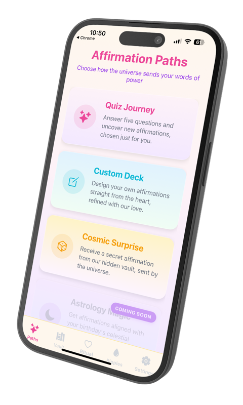
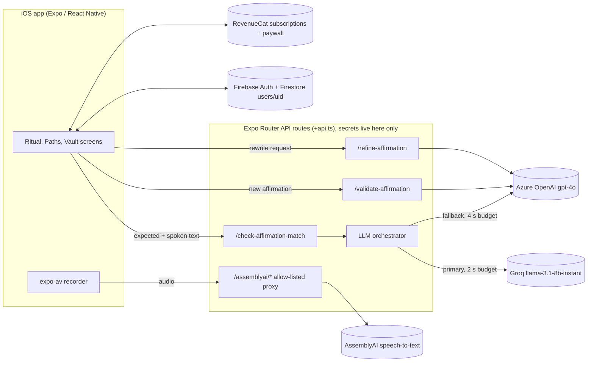

# Sayura: a voice-affirmation app with an LLM speech-matching loop

Sayura was an iOS app on the App Store (the listing is no longer live). You picked or wrote an affirmation, said it
out loud, and the app checked that what you said matched what you meant to say before counting it towards your
streak. This repo is the full app source (Expo / React Native, about 10,800 lines of TypeScript) plus its small
marketing site, open-sourced with a fresh history and all keys and identifiers removed.

<p align="center">
  
</p>

## The problem

Affirmation apps are mostly text you read and forget. The idea behind Sayura was that saying the words aloud,
every day, is the habit worth building, so the app had to *listen*: record the user, turn speech into text, and
decide whether the attempt counts. Three things made that harder than a string comparison:

- **Speech is messy.** People say "um", reorder words, swap "I'm" for "I am", and some users were not native
  English speakers. A strict match would fail people who did the practice properly.
- **It had to feel instant.** The check runs after every spoken repetition in a ritual, so a
  slow model breaks the rhythm.
- **Affirmations can be public.** Users could share affirmations with the community, so user-written ones needed
  a moderation pass, and badly worded ones benefit from a gentle rewrite.

## Approach



### The LLM orchestration design

The speech check lives in [`app/services/llm/`](app/services/llm/) and is small on purpose:

- **One interface, two providers.** `LLMProvider` has two methods, `isAvailable()` and
  `checkAffirmationMatch(expected, spoken)`, and returns a typed `LLMResult` (`success`, `matchScore`,
  `explanation`, `provider`, `latency`). [`GroqProvider`](app/services/llm/groq-provider.ts) and
  [`AzureProvider`](app/services/llm/azure-provider.ts) implement it.
- **Fast model first, strong model as fallback.** The orchestrator tries Groq's `llama-3.1-8b-instant` with a 2 s
  timeout, then Azure OpenAI `gpt-4o` with double the budget. Every provider call races a timeout, so a slow
  provider costs a bounded delay, not a hung ritual.
- **A score, not a yes/no.** The model returns a 0-100 `matchScore` against a written rubric (95+ near-perfect,
  70-84 core meaning kept, under 50 different or opposite meaning), with worked examples in the prompt. The app
  counts a repetition at 70 or above. The prompt tells the model to ignore filler words and minor grammar and to
  be generous to non-native speakers, because the goal is the practice, not elocution.
- **JSON only, then parse defensively.** Prompts demand a bare JSON object; the providers strip code fences and
  check the shape (`matchScore` is a number, `explanation` a string) before returning. A timeout or API error
  falls through to the next provider; a reply that can't be parsed as JSON is scraped for a score, and if none is
  found the provider returns 75, which counts as a pass (generous by design, but worth tightening).
- **Separate single-purpose prompts** for moderation ([`validate-affirmation+api.ts`](app/validate-affirmation+api.ts):
  accept or reject with a reason) and rewriting ([`refine-affirmation+api.ts`](app/refine-affirmation+api.ts)),
  each on gpt-4o, where quality matters more than latency.

Everything that needs a secret runs in Expo Router API routes. The app only knows the server's origin
(`EXPO_PUBLIC_API_BASE_URL`); AssemblyAI calls go through an allow-listed proxy
([`app/assemblyai/[...path]+api.ts`](app/assemblyai/)) that adds the key server-side and forwards only the
upload, create-transcript and poll calls.

### Rest of the stack

| Concern | Choice | Where |
| --- | --- | --- |
| App framework | Expo SDK 54, React Native 0.81, Expo Router 6 (file-based tabs + API routes) | `app/` |
| Speech-to-text | AssemblyAI (`slam-1` model): upload, create, poll | `app/assemblyai/`, `app/transcribe+api.ts` |
| Auth | Firebase Auth: Google, Apple, email, anonymous | `app/login-simple.tsx`, `app/email-auth.tsx` |
| Data | Firestore, one `users/{uid}` doc + `affirmations` subcollection, with an AsyncStorage cache | `app/services/firestore.ts`, `firestore.rules` |
| Subscriptions | RevenueCat SDK + RevenueCat paywall UI | `app/config/revenuecat.ts`, `app/paywall.tsx` |
| Progress model | "Ripple Galaxy": streaks, ripples, rings | [`docs/RIPPLE_ALGORITHM.md`](docs/RIPPLE_ALGORITHM.md) |
| Marketing site | Vite + React + Tailwind landing page and privacy policy | `site/` |

## Results

Sayura shipped to the App Store with the full paid-app plumbing: RevenueCat subscriptions and paywall, Firebase
accounts with Google, Apple and anonymous sign-in, and in-app account deletion. Growth was the hard part: one
organic TikTok video for the app reached about 70,000 views and brought in fewer than 10 sign-ups. That gap, and
what it says about short-form video as a channel, is written up in
[70,000 views, fewer than 10 sign-ups](https://tonytonggg.com/writing/views-are-not-signups).

## Quickstart (with your own keys)

You need Node 20+, and for a device build Xcode or Android Studio. Nothing here talks to the original Firebase
project, RevenueCat app or App Store listing; you bring your own.

```bash
npm install
cp .env.example .env          # fill in your own keys (see below)
npm run typecheck             # tsc --noEmit (app and tests), passes clean
npm test                      # vitest: offline unit tests, no keys or network needed
npm run dev                   # Metro + API routes on :8081
```

Minimum to see the voice loop work:

1. **Server keys** in `.env`: `ASSEMBLYAI_API_KEY`, plus `GROQ_API_KEY` and/or the three `AZURE_OPENAI_*` values.
2. **Firebase:** create a project, enable Auth (Anonymous is enough to start) and Firestore, put the web config in
   the `FIREBASE_*` values, download your own `GoogleService-Info.plist` to the project root (it is git-ignored),
   and deploy the rules with `firebase deploy --only firestore:rules`.
3. **`EXPO_PUBLIC_API_BASE_URL`**: the address your phone can reach the dev server on (your LAN IP and port 8081).
4. **Native build:** `ios/` and `android/` are not committed; they are generated from `app.config.js`. Run
   `npx expo prebuild` then `npm run ios`, or use an EAS development build. Expo Go cannot load the native
   Google sign-in and RevenueCat modules.
5. RevenueCat is optional for local runs; without `REVENUE_CAT_PUBLIC_SDK_KEY` the app logs a warning and the
   paywall has no offerings.

Smoke-test the orchestrator once the dev server is running:

```bash
API_BASE_URL=http://localhost:8081 npm run test:llm   # 4 expected/spoken pairs: score, provider, latency
```

The marketing site runs on its own: `cd site && npm install && npm run dev`.

## Repo layout

```
app/
  (tabs)/                        Ritual (index), Paths, Vault, Profile, Leaderboard (hidden) screens
  services/llm/                  LLM orchestrator + Groq and Azure providers
  services/firestore.ts          Firestore data access
  api/                           server-side match handler used by the route below
  assemblyai/[...path]+api.ts    allow-listed AssemblyAI proxy
  check-affirmation-match+api.ts, validate-affirmation+api.ts, refine-affirmation+api.ts, transcribe+api.ts
  config/                        Firebase and RevenueCat setup
  utils/                         local + Firestore storage, quiz and "cosmic" affirmation generators
lib/api.ts                       apiUrl(): the only server address the app knows
docs/                            product/UX notes, Ripple Galaxy scoring model, screenshot
site/                            marketing site (Vite + React)
scripts/                         LLM provider smoke test
tests/                           vitest: LLM fallback, score parsing, server-route and client key boundary
firestore.rules                  per-user read/write rules
app.config.js                    Expo config; identifiers come from env (placeholder bundle ID com.example.sayura)
```

## Design decisions and lessons

- **Fast-then-strong fallback was the right shape; the health check was not.** `GroqProvider.isAvailable()` makes
  a 1-token completion before every real call, which adds a round trip to the path it is meant to speed up. A
  circuit breaker (skip a provider for N seconds after M failures) gives the same protection without the cost.
- **A generous rubric beat a strict one.** Scoring 0-100 against a written rubric and counting 70+ let the app
  forgive filler words and accents while still rejecting a different sentence. It would be better still with a
  small labelled set of real (expected, spoken) pairs to tune the threshold against, instead of four hand-written
  smoke tests.
- **Run the type checker in CI.** Metro bundles TypeScript without checking it, and the shipped code had 71 `tsc`
  errors, including a hidden screen importing functions that did not exist in the storage module it pointed at:
  two storage layers (AsyncStorage and Firestore) with near-identical APIs had drifted apart. This copy
  type-checks clean. The fixes are type-level and keep runtime behaviour the same, apart from pointing that
  import at the right module and adding one missing style.
- **Distribution is a separate problem from the product.** The app worked; reach did not turn into installs.
  See the [article](https://tonytonggg.com/writing/views-are-not-signups).

### Known limitations of this copy

- The API routes have no auth or rate limiting. Before deploying them publicly, verify a Firebase ID token on each
  request and cap calls per user.
- `expo-av`'s `Recording.getStatusAsync()` does not return `isLoaded`, so the cleanup branches that check it never
  run. Behaviour is kept as shipped and the check is cast rather than rewritten.
- The leaderboard screen is hidden in the tab bar and reads local data only.
- Not run on a device for this release. Verified with `tsc --noEmit`, `expo export --platform web` (all five API
  routes bundle) and local calls to the routes with no keys set (each returns a clear "not configured" error).

## Licence

MIT, copyright Tony Tong. See [LICENSE](LICENSE). The singing-bowl sound in `assets/` is a free sound-effect file
bundled with the app; check its licence before reusing it outside this project.
